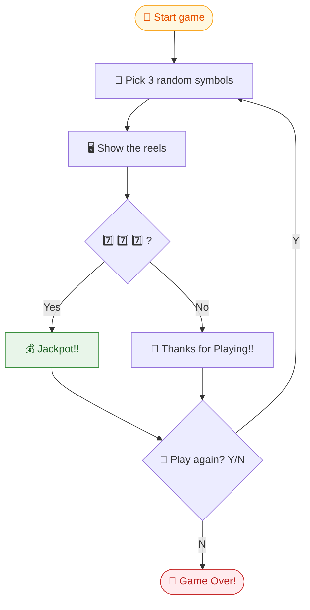

<div align="center">



<br/>


<br/>

**[✨ Features](#-features)** &nbsp;|&nbsp;
**[🖥️ Demo](#️-demo)** &nbsp;|&nbsp;
**[🔄 How It Works](#-how-it-works)** &nbsp;|&nbsp;
**[▶️ How to Run](#️-how-to-run)** &nbsp;|&nbsp;
**[🎓 What You Learn](#-what-you-learn)**

</div>

---

## 📖 About

A simple slot machine game built with **Python** using the `random` module.

Each spin randomly selects **three symbols**. Land three `7️⃣` and you hit the **jackpot**! After every spin, you decide whether to play again.

> 🎯 **Goal:** Get **7️⃣ | 7️⃣ | 7️⃣** on the reels.

The game uses four symbols (🍒 🍇 🍉 7️⃣), each equally likely on every reel, so the jackpot comes up about **1 in 64 spins**.

---

## ✨ Features

| | |
|:---|:---|
| 🎲 **Random reels** | Three symbols are picked randomly on every spin |
| 💰 **Jackpot system** | Three `7️⃣` symbols win the jackpot |
| 🔁 **Replay option** | A `while` loop lets you keep playing |
| ⌨️ **Simple input** | Type `N` to quit; any other answer plays another round |
| 🌱 **Beginner-friendly** | Short, readable code, ideal for learning Python |

---

<div align="center"></div>

## 🖥️ Demo

```text
🍇 | 🍉 | 🍒
Thanks for Playing!!
Play again? (Y/N): Y

7️⃣ | 7️⃣ | 🍒
Thanks for Playing!!
Play again? (Y/N): Y

7️⃣ | 7️⃣ | 7️⃣
Jackpot!!
Play again? (Y/N): N

Game Over!
```

---

<div align="center"></div>

## 🔄 How It Works



---

<div align="center"></div>

## ▶️ How to Run

**Requirements:** [Python 3](https://www.python.org/downloads/) installed on your computer.

**1️⃣ Download or clone the project**

**2️⃣ Open a terminal in the project folder**

**3️⃣ Run the game**

```bash
python slot_machine.py
```

> 💡 On some systems you may need to use `python3 slot_machine.py` instead.

---

## 🎓 What You Learn

| Concept | Where it's used |
|:---|:---|
| 🎲 **`random` module** | Picking random symbols for each spin |
| 🔁 **`while` loop** | Replaying the game until the player quits |
| 🔀 **Conditions (`if` / `else`)** | Checking for the jackpot |
| ⌨️ **User input** | Reading the `Y` / `N` answer |

---

## 🔮 Ideas to Extend

- [ ] 🪙 Add a starting balance and betting
- [ ] 🍋 Add more symbols and smaller prizes
- [ ] 🎨 Add colors to the terminal output
- [ ] 🏆 Track wins and total spins
- [ ] 🔊 Add sound effects

---

<div align="center">



*Made with Python & 🍀*

</div>
